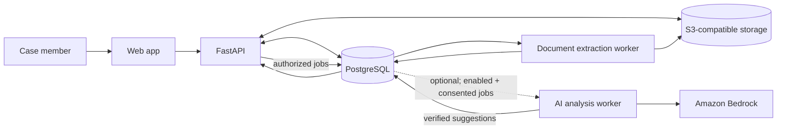

# Washington Divorce Mediation Workspace

An AI-assisted workspace for organizing documents, reviewing property information, and preparing settlement proposals for Washington divorce cases without children.

[](https://github.com/whyi/WA-contested-divorce-without-children-mediation-to-end/actions/workflows/test.yml)
[](https://github.com/whyi/WA-contested-divorce-without-children-mediation-to-end/actions)
[](https://www.python.org/)
[](LICENSE)

[Live demo: coming soon](#live-demo) · [Project board](https://github.com/users/whyi/projects) · [Roadmap](https://github.com/whyi/WA-contested-divorce-without-children-mediation-to-end/milestones) · [Issues](https://github.com/whyi/WA-contested-divorce-without-children-mediation-to-end/issues)

> **Important:** This is an organizational tool, not legal advice. It does not determine legal rights or guarantee an outcome. Use fictional information in demos; do not submit real case information to local previews or unverified deployments.

## What it does

- Organizes case materials and keeps extracted text linked to its source pages.
- Helps users review property facts and compare settlement scenarios.
- Uses optional, consent-based AI to suggest source-grounded information. Suggestions require user review and are never applied automatically.
- Prepares editable proposal documents for users to review.

AI features are disabled by default and require explicit configuration and purpose-specific consent. The repository does not establish provider-side data handling or legal approval.

## Architecture



The local preview uses Docker Compose, PostgreSQL, and a local S3-compatible service. A hosted demo is not live yet; AWS ECS/Fargate is the planned deployment direction.

## Project status

Planning and delivery are tracked in [GitHub Projects](https://github.com/users/whyi/projects), with work grouped into repository milestones and linked issues and pull requests.

| Track | Focus | Status |
|---|---|---|
| [v0.2 core implementation](https://github.com/whyi/WA-contested-divorce-without-children-mediation-to-end/milestone/2) | Core workflows, legal/product boundaries, and foundation | In progress |
| [Pre-launch readiness](https://github.com/whyi/WA-contested-divorce-without-children-mediation-to-end/milestone/3) | Usability, security, payments, release checks, and beta readiness | In progress |
| [Owner-only beta / UAT](https://github.com/whyi/WA-contested-divorce-without-children-mediation-to-end/issues/209) | Isolated AWS environment and repeatable synthetic-case testing | In progress |

Recent delivery: [AWS UAT infrastructure](https://github.com/whyi/WA-contested-divorce-without-children-mediation-to-end/pull/216), [guarded test-data reset](https://github.com/whyi/WA-contested-divorce-without-children-mediation-to-end/pull/219), [repeatable UAT suite](https://github.com/whyi/WA-contested-divorce-without-children-mediation-to-end/pull/221), and [operational alarms and runbook](https://github.com/whyi/WA-contested-divorce-without-children-mediation-to-end/pull/222).

Browse work by type: [all open issues](https://github.com/whyi/WA-contested-divorce-without-children-mediation-to-end/issues?q=is%3Aissue+is%3Aopen), [bugs](https://github.com/whyi/WA-contested-divorce-without-children-mediation-to-end/issues?q=is%3Aissue+is%3Aopen+label%3Abug), [enhancements](https://github.com/whyi/WA-contested-divorce-without-children-mediation-to-end/issues?q=is%3Aissue+is%3Aopen+label%3Aenhancement), and [specification work](https://github.com/whyi/WA-contested-divorce-without-children-mediation-to-end/issues?q=is%3Aissue+is%3Aopen+label%3Aspecification).

## Live demo

**Coming soon.** No hosted demo URL is available yet. The local Compose preview is for development and fictional data only.

## Run locally

```sh
docker compose up --build
```

The current Compose configuration publishes the app at `http://192.168.1.17:8001`; API documentation is available at `/docs`.

Run the test suite with:

```sh
bash harness/validate.sh
```

## Tech

Python 3.11+, FastAPI, PostgreSQL, S3-compatible object storage, and Docker Compose.

## Project links

- [Deployment notes](deploy/aws/owner-beta/README.md)
- [Owner-only UAT runbook](deploy/aws/owner-beta/uat-runbook.md)
- [Specifications](specs/)
- [License](LICENSE)
