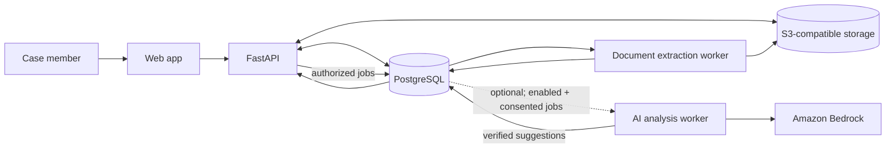

# Washington Divorce Mediation Workspace

An AI-assisted workspace for organizing documents, reviewing property information, and preparing settlement proposals for Washington divorce cases without children.

[](https://github.com/whyi/WA-contested-divorce-without-children-mediation-to-end/actions/workflows/test.yml)
[](https://github.com/whyi/WA-contested-divorce-without-children-mediation-to-end/actions)
[](https://www.python.org/)
[](LICENSE)

[Live demo: coming soon](#live-demo) · [Project board](https://github.com/users/whyi/projects) · [Roadmap](https://github.com/whyi/WA-contested-divorce-without-children-mediation-to-end/milestones) · [Issues](https://github.com/whyi/WA-contested-divorce-without-children-mediation-to-end/issues)

> **Important:** This is an organizational tool, not legal advice. It does not determine legal rights or guarantee an outcome. Use fictional information in demos; do not submit real case information to local previews or unverified deployments.

## What it does

- Organizes case materials and keeps extracted text linked to its source pages.
- Helps users review property facts and compare settlement scenarios.
- Uses optional, consent-based AI to suggest source-grounded information. Suggestions require user review and are never applied automatically.
- Prepares editable proposal documents for users to review.

AI features are disabled by default and require explicit configuration and purpose-specific consent. The repository does not establish provider-side data handling or legal approval.

## Architecture



The local preview uses Docker Compose, PostgreSQL, and a local S3-compatible service. A hosted demo is not live yet; AWS ECS/Fargate is the planned deployment direction.

## Project status

Planning and delivery are tracked in [GitHub Projects](https://github.com/users/whyi/projects), with work grouped into repository milestones and linked issues and pull requests.

| Track | Focus | Status |
|---|---|---|
| [v0.2 core implementation](https://github.com/whyi/WA-contested-divorce-without-children-mediation-to-end/milestone/2) | Core workflows, legal/product boundaries, and foundation | In progress |
| [Pre-launch readiness](https://github.com/whyi/WA-contested-divorce-without-children-mediation-to-end/milestone/3) | Usability, security, payments, release checks, and beta readiness | In progress |
| [Owner-only beta / UAT](https://github.com/whyi/WA-contested-divorce-without-children-mediation-to-end/issues/209) | Isolated AWS environment and repeatable synthetic-case testing | In progress |

Recent delivery: [AWS UAT infrastructure](https://github.com/whyi/WA-contested-divorce-without-children-mediation-to-end/pull/216), [guarded test-data reset](https://github.com/whyi/WA-contested-divorce-without-children-mediation-to-end/pull/219), [repeatable UAT suite](https://github.com/whyi/WA-contested-divorce-without-children-mediation-to-end/pull/221), and [operational alarms and runbook](https://github.com/whyi/WA-contested-divorce-without-children-mediation-to-end/pull/222).

Browse work by type: [all open issues](https://github.com/whyi/WA-contested-divorce-without-children-mediation-to-end/issues?q=is%3Aissue+is%3Aopen), [bugs](https://github.com/whyi/WA-contested-divorce-without-children-mediation-to-end/issues?q=is%3Aissue+is%3Aopen+label%3Abug), [enhancements](https://github.com/whyi/WA-contested-divorce-without-children-mediation-to-end/issues?q=is%3Aissue+is%3Aopen+label%3Aenhancement), and [specification work](https://github.com/whyi/WA-contested-divorce-without-children-mediation-to-end/issues?q=is%3Aissue+is%3Aopen+label%3Aspecification).

## Live demo

**Coming soon.** No hosted demo URL is available yet. The local Compose preview is for development and fictional data only.

## Run locally

```sh
docker compose up --build
```

The current Compose configuration publishes the app at `http://192.168.1.17:8001`; API documentation is available at `/docs`.

With the default local-only demo configuration, sign in using username `demo` and password `demo`. These credentials are for the fictional demo only; real case-data APIs remain disabled. Do not provision this demo user in production or enable demo mode on a deployed environment.

For login over the LAN address (including Remote SSH development), use the optional local HTTPS proxy; plain-HTTP LAN connections cannot retain secure authentication cookies:

```sh
mkdir -p .local-tls
openssl req -x509 -newkey rsa:2048 -nodes -days 30 \
  -keyout .local-tls/key.pem -out .local-tls/cert.pem \
  -subj "/CN=192.168.1.17" -addext "subjectAltName=IP:192.168.1.17"
chmod 600 .local-tls/key.pem
docker compose -f docker-compose.yml -f docker-compose.local-https.yml up -d local-https
```

Open `https://192.168.1.17:8443` and accept the self-signed certificate warning only for this local preview, or trust this certificate on your development device. The private key stays in the ignored `.local-tls/` directory. This is not a production TLS setup; do not reuse this certificate for deployment.

### Persistent fictional test account

To test actual case creation and saving, use the separate local-test project rather than enabling case APIs in demo mode. It uses its own PostgreSQL volume and Moto buckets, secure cookies, no AI, and a local-only Mailpit inbox instead of external email delivery. Existing Compose data is not changed. Use fictional data only.

After generating the local TLS certificate above, generate local credentials once (do not regenerate them while retaining the test database):

```sh
umask 077
printf 'AUTH_JWT_SECRET=%s\nAUTH_ENCRYPTION_KEY=%s\n' \
  "$(openssl rand -hex 32)" "$(openssl rand -hex 32)" > .local-tls/local-test.env
openssl rand -hex 24 > .local-tls/local-test-password
docker compose -f docker-compose.local-test.yml up -d --build
docker compose -f docker-compose.local-test.yml run --rm seed-account
```

Open `https://192.168.1.17:8444/?auth=login`, accept only the local certificate warning, enter `local-test@example.com`, select Continue, then sign in with the password in `.local-tls/local-test-password`. The same seed also provisions `essential-test@localhost.invalid` with that same password, a separate case, paid/Essential entitlement and five local test credits. Its one-time grant is explicitly synthetic, not a Stripe payment; rerunning does not refill spent credits or change existing work or passwords. Both addresses are fictional test identifiers with verified seeded accounts. The reserved `.invalid` login is accepted only in the isolated local-test database.

New email signup uses Verify email beside the address and a five-minute token before account creation. Local verification messages appear at `http://127.0.0.1:8026` on the Docker host; use VS Code port forwarding for remote development. This inbox is deliberately not exposed to the LAN, and messages do not reach real email addresses. Hosted deployments need working SMTP settings.

The compact login/signup entry has no preview copy or account tabs. Continue follows login or signup intent without querying whether an email has an account; the next form can switch between those actions. Google first requires site consent, and declining sends no provider request and creates no account/link. Only Google is supported and it still requires configured OIDC credentials. Email signup requires verified email, both names, password and explicit agreement; it establishes a session and opens Account. Returning sign-ins preserve their case destination. Authenticated navigation includes Log out beside Account, including on signed-in home. The shared accepted page starts higher with no generic section spacer. Terms and Privacy Notice are draft account notices requiring counsel review before launch. See [spec 97](specs/97-email-first-signup-and-logout/spec-97-email-first-signup-and-logout.md).

The account starts with Free entitlement and a single preparation attempt. **I have documents** opens the demo-aligned document-selection layout, without the former upload/analysis page. An optional offer/counteroffer checkbox beneath the selected-file list reveals autosaved text notes and PDF/DOCX attachment only when checked. Saved details return after reload. **Back** on the left returns to the existing case's mode selection; **Next** on the right saves any checked offer and selected files, then opens Asset Overview. Selection stays on the device until saved. Real Asset Overview and Case file management reuse the demo layouts without the duplicate source-record section: missing balances stay unavailable and dated overrides are saved with revision checks. Source records remain preserved in storage and case export.

Uploaded files retain their exact original names in the file manager and downloads. Adding the same case-sensitive filename asks **Overwrite it?**; declining cancels that upload. Confirmed overwrite preserves the old file until the new upload is stored, works at the attachment quota and retries unfinished cleanup without another upload. Existing offer references follow the new file. There are no Replace or Refresh saved files buttons; lists update after mutations. Legacy files whose original names were not stored show an unavailable-name label rather than an invented name. The filename migration runs automatically when the API starts.

Scenario ideas include the same Word/Excel download actions as the demo. A selected available scenario exports saved start/division-date balances and its 55%, 50% or 45% share of net change, not fictional values. Word uses the existing unsigned CR 2A template; Excel includes dated balances and a scenario summary. Draft downloads preserve editability, consume no credits and do not send a proposal. Missing data and stale revisions fail explicitly; archived attempts export their saved profile. See [spec 91](specs/91-original-filenames-and-confirmed-overwrite/spec-91-original-filenames-and-confirmed-overwrite.md) and [spec 92](specs/92-real-scenario-draft-downloads/spec-92-real-scenario-draft-downloads.md).

The full response section below those downloads also matches the demo. After both current documents are downloaded, **I reviewed and sent the final documents** records the user's mediator delivery and freezes that attempt's proposal values. Choose counteroffer, rejection or acceptance; notes autosave and PDF/DOCX/XLSX counteroffer attachments keep their original names. Responses restore after reload. Free cannot create a second attempt; its counteroffer Next remains visible with disabled styling and shows an upgrade alert when activated, without continuing. Only one plan-limit notice is shown. Paid cases can continue within the three-attempt limit. Acceptance opens the same guidance as the demo, without a file chooser or completion button; the sole bottom action, **Back to your case**, returns directly to Asset Overview without closing the case. Confirmed stop after rejection still uses reversible case closure, preserving data and credits. See [spec 93](specs/93-real-mediator-response-workflow/spec-93-real-mediator-response-workflow.md), [spec 94](specs/94-counteroffer-next-upgrade/spec-94-counteroffer-next-upgrade.md) and [spec 95](specs/95-accepted-page-demo-parity/spec-95-accepted-page-demo-parity.md).

Starting-point choices are normal landing pages, not popups, both for initial case creation and when returning with **Back**. They have no Cancel button. The optional offer checkbox sits below the document selection/list and above Back/Next. Asset Overview has no extra Snapshot date input, and real/demo screens have no floating attempt banner; the normal attempt navigation remains.

Starting-point pages use the document page's large heading and unboxed layout. Guided onboarding begins directly with the wizard's own introduction, without the extra preparation preamble or negotiation navigation; questionnaire saving and optional offer entry remain available.

Wizard completion becomes available after selecting filed-case status and role, entering marriage and petition-filing dates, and naming at least one asset or debt. Optional estimates and other sections need not be filled. Clearing required input disables completion again; partial drafts still autosave.

After document import and Next, case progress is persisted to the account. Home's **Your case**, sign-in, and direct entry resume the same Asset Overview instead of restarting document selection. Previously saved files, attempts, or asset snapshots also resume existing cases. Document **Back** still explicitly opens mode selection without clearing progress.

Real case/onboarding and acceptance/rejection pages require a verified active session even when their URLs are entered directly. Logged-out or expired sessions return to `/` before working-page HTML is served; restored browser-history pages also recheck authentication. The homepage, public demos and authentication/recovery endpoints remain available without signing in. See [spec 96](specs/96-working-page-session-gate/spec-96-working-page-session-gate.md).

The current-attempt circle on Asset Overview is noninteractive in real cases and demos. Saved archive circles remain selectable; from an archive, the current circle can return to the working attempt.

Guided intake uses bottom Back/Next buttons. Offer details autosave without a
separate save button; document selection is retained locally when returning to
mode selection. The working mode is marked with an asterisk. Switching to the
other mode requires Yes/No confirmation: Yes permanently clears all onboarding
inputs and selected/uploaded files before starting again; No keeps the work.
Discard is unavailable after entering an attempt workspace.

Real Asset Trend supports clicking or dragging the start/division dates, snapping
to saved dates. Scenario ideas always display the shared three cards: complete
saved endpoint balances produce real-data comparisons; missing values display
Unavailable with disabled options rather than fictional or inferred amounts.

The API and extraction worker share the Moto service's network namespace so storage remains on loopback without relaxing application endpoint validation. Bootstrap applies migrations and initializes the deletion ledger only when missing, using the repository's tombstone-aware initializer. Only the HTTPS proxy is LAN-published; the local mail inbox is bound to host loopback. PostgreSQL case data persists; Moto document objects and Mailpit messages are in-memory and do not survive replacement of those containers. Run subsequent local-test commands with `-f docker-compose.local-test.yml`; use `stop`, not volume deletion, to preserve test cases.

Run the test suite with:

```sh
bash harness/validate.sh
```

## Tech

Python 3.11+, FastAPI, PostgreSQL, S3-compatible object storage, and Docker Compose.

## Project links

- [Deployment notes](deploy/aws/owner-beta/README.md)
- [Owner-only UAT runbook](deploy/aws/owner-beta/uat-runbook.md)
- [Specifications](specs/)
- [License](LICENSE)
